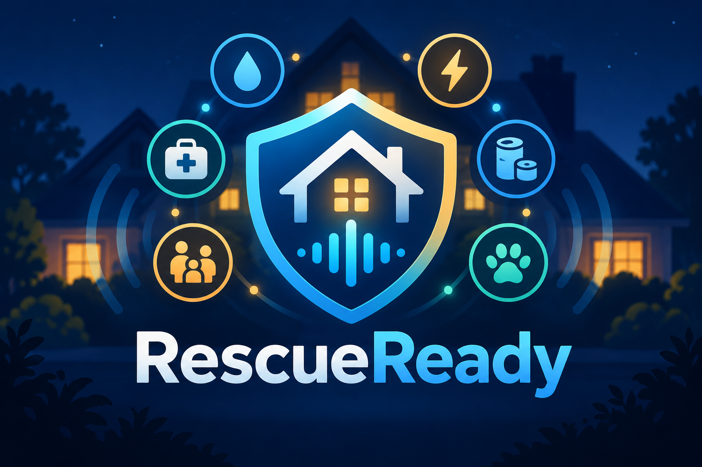
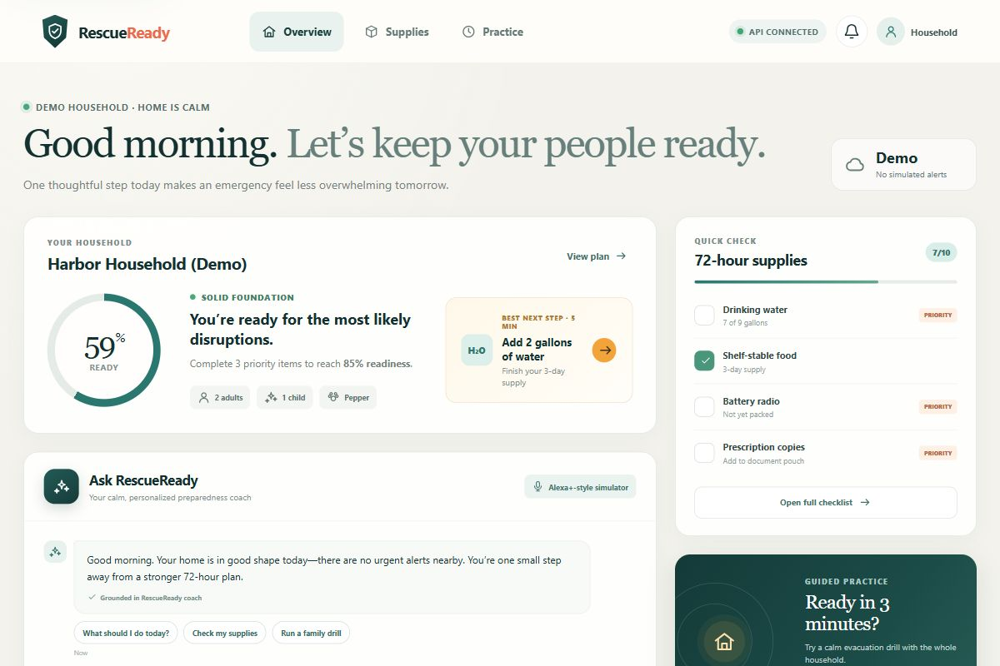
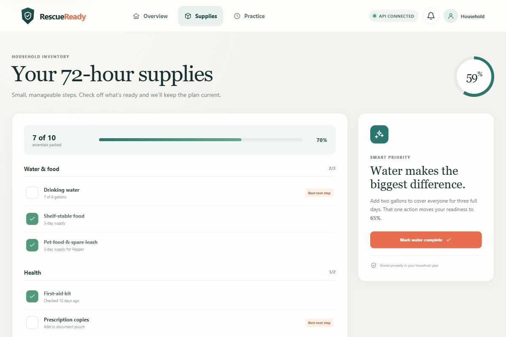
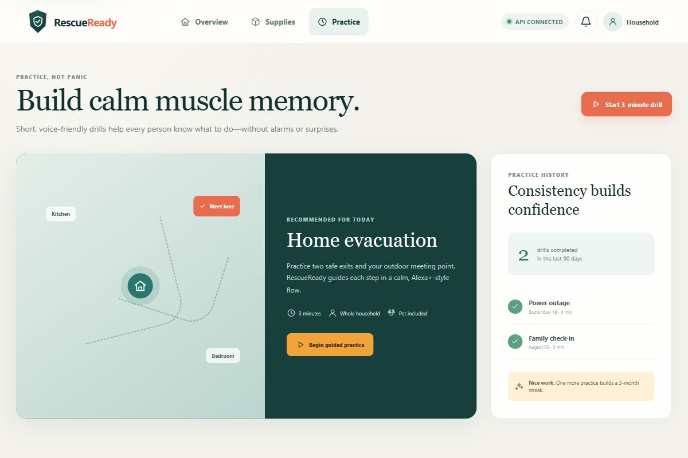
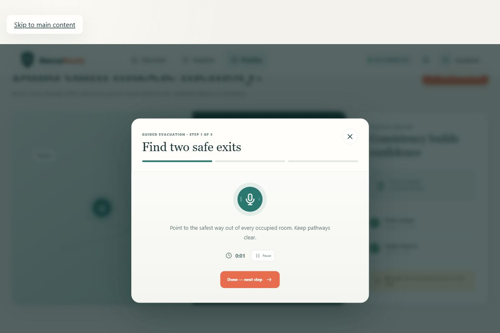

# RescueReady

**An Alexa+ preparedness coach that turns an overwhelming emergency checklist
into a personalized plan, a visible readiness score, and short household
practice drills.**

RescueReady was created for the Build, Ship, Shape: Amazon Developer Hackathon.
It includes a polished Alexa+-style web simulator and a real self-hosted Model
Context Protocol (MCP) service using Streamable HTTP. The full demo works
locally without AWS credentials, while an optional Amazon Bedrock adapter can
be enabled and then verified for an AWS Builder integration.



## Why it matters

Preparedness guidance is usually generic and long. RescueReady adapts small,
voice-friendly actions to a household's people, pets, mobility needs, supplies,
and chosen scenario. It is explicitly a preparation and practice tool—not a
replacement for emergency services or official local guidance.

## What is included

- A responsive React + TypeScript simulator with chat, readiness score, supply
  checklist, practice drill, and an observable agent activity trace.
- A TypeScript MCP service with a Streamable HTTP endpoint at `/mcp`.
- Six MCP tools: household read/update, plan generation, supply readiness,
  drill start, and drill-step completion.
- Versioned REST endpoints used by the simulator.
- Deterministic fictional demo data so reviewers can run everything without
  accounts, hardware, or secrets.
- Optional Amazon Bedrock Converse integration with a safe local fallback.
- Automated service, API, MCP, and frontend tests.
- Devpost story, architecture diagram, demo script, and judging checklist.

## Quick start

Requirements: Node.js 20.19 or later and npm.

```bash
npm install
npm run dev:server
```

In a second terminal:

```bash
npm run dev:web
```

Open `http://localhost:5173`. The API listens on `http://127.0.0.1:8787`, and
the MCP endpoint is `http://127.0.0.1:8787/mcp`.

The web app also has a complete browser-only fallback. If the service is not
running, the status pill changes to **Demo ready** and the core flow remains
interactive.

## Verify the project

```bash
npm run typecheck
npm test
npm run build
```

Server-specific details, REST examples, and MCP endpoint tests are in
[server/README.md](server/README.md).

## Optional Amazon Bedrock mode

The default `AI_PROVIDER=mock` mode is deterministic and needs no credentials.
To test a real Bedrock integration, copy the server environment example, use an
AWS profile or another standard credential provider, then set:

```dotenv
AI_PROVIDER=bedrock
AWS_REGION=us-east-1
BEDROCK_MODEL_ID=amazon.nova-lite-v1:0
```

Never put AWS credentials in this repository or in the frontend. Only describe
Bedrock as a completed hackathon integration after the call has been run and
captured in the demo.

## Demo flow

1. Ask the web simulator to prepare the fictional household for a power outage.
2. Show the browser-local activity trace and personalized plan returned by the
   REST API or deterministic fallback.
3. Open the supply checklist and identify the highest-priority gaps.
4. Start a three-minute guided drill and complete each step.
5. Separately demonstrate the `/mcp` endpoint with an MCP client, then show the
   architecture diagram.

See [docs/demo-script.md](docs/demo-script.md) for the complete 2–3 minute
script and [docs/architecture.md](docs/architecture.md) for the system design.

## Gallery









## Repository map

```text
rescueready/
├── assets/        Devpost-ready 3:2 thumbnail
├── docs/          Architecture, story, demo, and judging checklist
├── server/        MCP + REST service and tests
└── web/           React simulator and offline demo engine
```

## Safety and privacy

- The demo household is fictional.
- No real address, medical history, or precise location is required.
- RescueReady prepares and practices; it does not diagnose, dispatch help, or
  advise anyone to delay evacuation.
- During a real emergency, follow local authorities and contact local emergency
  services.

## License

MIT — see [LICENSE](LICENSE).
