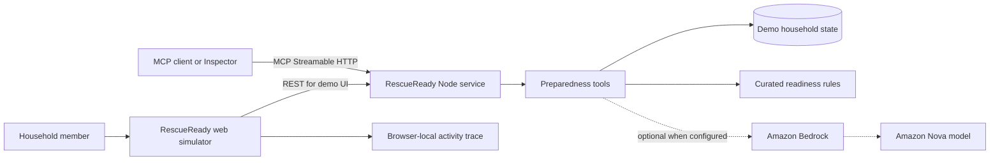

# RescueReady architecture

RescueReady is an Alexa+ preparedness-coach prototype built around a
self-hosted Model Context Protocol (MCP) server. The browser app is an
Alexa+-style simulator that uses the service's REST API and displays a
browser-local activity trace. MCP behavior is demonstrated separately through
the Streamable HTTP endpoint with a compatible client.

## MCP tools

- `get_household_profile` reads the fictional demo household.
- `update_household_profile` changes household needs and preferences.
- `generate_preparedness_plan` creates a prioritized, accessible plan.
- `check_supply_readiness` identifies gaps and calculates readiness.
- `start_drill` starts a short voice-friendly drill.
- `complete_drill_step` records progress one safe step at a time.

## Safety and privacy

- The bundled profile is fictional. The demo does not require real names,
  addresses, medical details, or precise location.
- RescueReady is for preparation and practice, not live emergency response.
  In an active emergency, the interface directs people to local authorities.
- Deterministic local behavior keeps the demo testable without cloud
  credentials. A Bedrock adapter can be enabled separately for documented AWS
  integration and should never expose credentials to the browser.

## Deployment target

A potential deployment is a static frontend plus the Node service on an
AWS-managed runtime. Record the exact deployed services and URLs in the
submission only after they have been created and verified.
